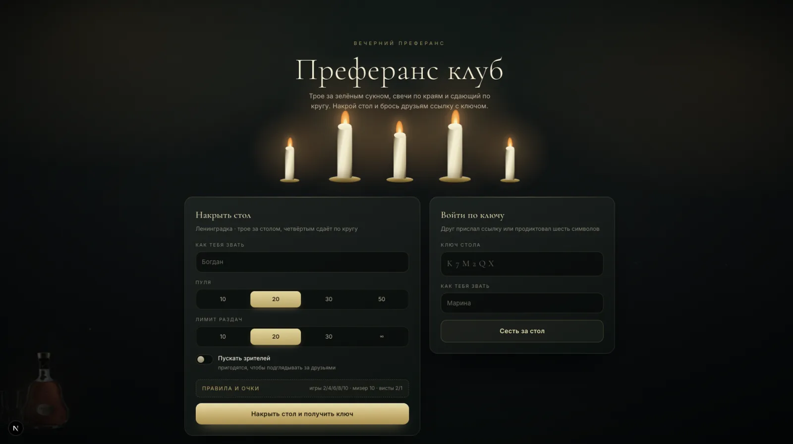
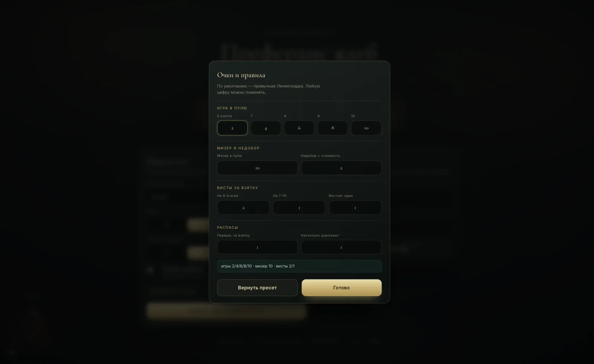

# Преферанс клуб

Камерный преферанс для игры с друзьями по сети: свой сервер на домашней машине,
Postgres в Docker и веб-стол со свечами, сукном и чатом.

Ленинградка втроём: торговля, прикуп со сносом, висты, взятки, пуля/гора/висты,
распасы. За одним столом можно играть с друзьями и ботами трёх уровней
(новичок / игрок / мастер) — их ходы делает сервер: Монте-Карло по скрытым
картам плюс альфа-бета докрутка раздачи, оценка хода в очках (см. «Мозг
компьютера»). Цифры очков (стоимость игр, мизер, висты, распасы) настраиваются
в зале в диалоге «Правила и очки» и хранятся вместе с игрой. Голос — следующий
этап.

## Скриншоты

| | |
| --- | --- |
|  |  |
| Зал: свечи, сукно и вход по ключу | Торговля: заказ игры с руки |
|  |  |
| Прикуп открыт: заказ можно поднять, две лишние — на снос | Взятка лежит на сукне, пока все не нажмут «Ок» |
|  |  |
| Итоги раздачи: гора и висты в дельтах | Диалог «Правила и очки» — цифры под свою компанию |

---

## Что нужно

| Зависимость | Версия | Зачем |
| --- | --- | --- |
| Node.js | **26.8.1** (см. `.nvmrc`) | Prisma 7 не поддерживает Node 23.x и ниже |
| pnpm | 12.x | в `package.json` закреплён `packageManager` |
| Docker | любой свежий | Postgres 17 в контейнере |

```bash
nvm use          # подхватит 26.8.1 из .nvmrc
```

Без nvm: `export PATH="/Users/<you>/.nvm/versions/node/v26.8.1/bin:$PATH"`.
Если Node ниже 26.8.1, `prisma generate`/`migrate` падают на неподдерживаемой версии.

## Запуск

```bash
cp .env.example .env      # один раз
pnpm install              # postinstall сам сделает prisma generate
pnpm db:up                # Postgres 17 на 127.0.0.1:5433
pnpm db:migrate           # применить схему (или: pnpm exec prisma migrate deploy)
pnpm dev                  # Next + Socket.IO на одном порту
```

Открыть <http://localhost:3005>.

Порт **3005**, а не 3000: 3000 часто занят (например, Gotenberg в Docker).
Postgres слушает **5433**, чтобы не конфликтовать с локальным Postgres на 5432.

### Скрипты

| Команда | Что делает |
| --- | --- |
| `pnpm dev` | кастомный `server.ts` через `tsx watch` (Next dev + Socket.IO) |
| `pnpm build` / `pnpm start` | production-сборка Next и запуск того же сервера |
| `pnpm typecheck` | `tsc --noEmit` |
| `pnpm lint` | ESLint (включая `react-hooks`) |
| `pnpm db:up` / `pnpm db:down` | контейнер Postgres (`docker-compose.yml`) |
| `pnpm db:migrate` | `prisma migrate dev` |
| `pnpm db:studio` | Prisma Studio |

## Как играть с друзьями

1. На главной введите ник, выберите пулю и лимит раздач → **Создать стол**.
2. Откроется стол с ключом из 6 символов; в панели стола есть готовая ссылка
   вида `http://<host>:3005/g/G4NFDV`.
3. Каждый друг открывает ссылку, вводит свой ник и садится. Три места за
   столом (`PLAYING_SEATS`), четвёртый сдаёт по кругу.
4. Паролей нет: ник — это личность (хранится в cookie `pf_player`), ключ стола —
   это вход. Ник уникален без учёта регистра, по нему копится статистика.

### Доступ из интернета

Приложение слушает `0.0.0.0:3005`, поэтому достаточно пробросить порт на роутере.
Пропишите публичный адрес в `.env`, иначе ссылка-приглашение покажет локальный:

```env
APP_URL="https://salon.example.com"
```

Важно для голоса: `getUserMedia` работает только в **secure context** — HTTPS
либо `localhost`. По `http://192.168.x.x` микрофон браузер заблокирует. Варианты:

- туннель с TLS (Cloudflare Tunnel, ngrok, tailscale funnel) → адрес в `APP_URL`;
- reverse-proxy с сертификатом перед `3005`;
- для быстрой проверки — `http://localhost:3005` на машине, где открыт браузер.

## Устройство

```
server.ts                     Next + Socket.IO на одном порту (один адрес для проброса)
src/server/socket.ts          комнаты, presence, чат, rate limit 6 сообщений / 6 с
src/lib/protocol.ts           общие типы и события клиент↔сервер
src/lib/game-service.ts       создание стола, посадка, вид стола, история чата
src/lib/session.ts            cookie pf_player → пользователь
src/lib/validation.ts         zod-схемы входящих данных
src/lib/db.ts                 Prisma 7 + @prisma/adapter-pg
src/app/api/games/            POST /api/games, POST /api/games/[key]/join
src/app/g/[key]/page.tsx      RSC-загрузка стола + ссылка-приглашение
src/components/hall/          главный зал: ник, настройки, вход по ключу
src/components/table/         стол, места, чат, панель входа
src/components/cards/         карты с настоящей раскладкой пипсов и веер руки
src/app/globals.css           вся визуальная система: свечи, сукно, анимации
src/lib/preference/           движок Ленинградки: карты, раздача, торговля, взятки, пуля
prisma/schema.prisma          User / Game / GamePlayer / ChatMessage / GameResult
```

Стили — рукописный CSS (без Tailwind), шрифты через `next/font`
(Cormorant Garamond + Inter). Клиент Prisma генерируется в `src/generated/prisma`
и в git не попадает.

### Натюрморт в углу

`public/still/cognac-still.webp` — фотография (бутылка Hennessy X.O + два
стакана), а не рисунок. Как она собрана: бутылка вырезана по белому фону
(ключ по яркости), притушена под свет свечей; стаканы — CC0-кадр rawpixel
(через Openverse), чёрный фон снят luminance-ключом; сверху тёплая лужица
света и контактные тени, чтобы предметы не висели в воздухе. Размер на
странице задаёт `.ambience__still` в `globals.css` (`clamp(140px, 10.5vw, 180px)`).

### Проверка сокетов

Смоук-тест поднимает двух клиентов, проверяет `room:state`, presence и доставку
чата (нужны id двух игроков, сидящих за столом):

```bash
node scripts/socket-smoke.mjs G4NFDV <userIdA> <userIdB>
```

`userId` видно в Prisma Studio (`pnpm db:studio`) или в таблице `User`.

## Правила и очки

Движок в `src/lib/preference/` — чистая логика без БД и React:
`cards.ts` (32 листа, старшинство мастей), `deal.ts` (раздача от зерна),
`round.ts` (торговля → прикуп с Ок → снос → висты → взятки), `rules.ts`
(тип `Ruleset` и пресет), `score.ts` (пуля/гора/висты по цифрам из `Ruleset`),
`insight.ts`/`solver.ts`/`bot-smart.ts` (мозг компьютера, см. ниже).

### Мозг компьютера

Боты всех уровней играют через один движок (`bot-smart.ts`) с разным бюджетом:

| Уровень | Сэмплов на ход | Глубина поиска | Дедлайн | Шум |
| --- | --- | --- | --- | --- |
| новичок | 12 | 2 взятки | 350 мс | 10% случайных ходов |
| игрок | 48 | 3 взятки | 1,2 с | — |
| мастер | 120 | 4 взятки | 3 с | — |

Как думает бот (`insight.ts` → `solver.ts` → `bot-smart.ts`):

1. **Легальные знания.** Бот видит только свою руку, публичный снос, открытый
   прикуп, вышедшие карты и текущую взятку. Из истории он вычисляет ренонсы
   («не пошёл в масть — масти нет»). На распасах карты прикупа открываются
   по одной — в момент своей взятки: показанная известна всем, ещё скрытая
   исключена из расклада как «ничейная».
2. **Сэмплирование.** Невидимые карты раскладываются между чужими руками
   равновероятно, с учётом ренонсов и недискарднутого прикупа играющего.
3. **Докрутка раздачи.** Для каждого хода-кандидата раздача доигрывается
   альфа-бетой при полной информации (последние 3 взятки — точно до конца).
   Узлы соперников минимизируют полезность бота; в защите партнёр считается
   союзником.
4. **Оценка в очках, не во взятках.** Итог раздачи пропускается через
   `applyRoundScore`: ход выбирается по ожиданию «пуля − гора + висты
   относительно соперников» — поэтому бот осознанно вистует, сажается под
   чужие слабые заказы, избавляется от взяток на распасах и ловит мизер.
5. **Торговля и снос** оцениваются так же: ожидаемые взятки по козырям ×
   стоимость контракта против цены распасов; мизер — по вероятности чистоты
   на сэмплах прикупа.
6. **Бюджет и отказоустойчивость.** Поиск уступает event loop между сэмплами
   (сервер не замерзает), при исчерпании дедлайна доигрывает частичными
   средними, а в совсем невыполнимых случаях откатывается к простым
   эвристикам (`bot.ts`). Решения детерминированы: сид берётся из состояния
   раздачи.

Проверить уровень можно бенчмарком самопартий:

```bash
node --import tsx scripts/bot-bench.ts   # мастер против двух игроков, 8 раздач
```

### Цифры настраиваются за столом

В зале под именем есть строка **«Правила и очки»** — она открывает диалог, где
любая цифра меняется под свою компанию:

| Поле | Что задаёт |
| --- | --- |
| Игра в пулю (6–10) | стоимость игры в пулю |
| Мизер в пулю | очки за выполненный мизер |
| Недобор × стоимость | множитель штрафа за недобранные взятки |
| Висты: на 6-й / на 7–10 / вистует один | висты за взятку |
| Распасы: первый, за взятку / насколько дорожают | рост горы на распасах |

Пресет по умолчанию — `DEFAULT_RULESET` в `src/lib/preference/rules.ts`:

| Событие | Очки |
| --- | --- |
| Игра 6 / 7 / 8 / 9 / 10 | 2 / 4 / 6 / 8 / 10 в пулю |
| Бескозырка (6БК–10БК) | как игра уровнем выше: 4 / 6 / 8 / 10 / 10 в пулю, висты по ставке старшего уровня |
| Мизер выполнен | 10 в пулю |
| Вист за взятку: на 6-й игре | 2 (один вистующий — 1) |
| Вист за взятку: на 7–10 | 1 |
| Недобор: за каждую недобранную взятку | 2 × стоимость игры в гору |
| Недобор на висте | 6-я: по 2 с каждого (один — 4); 7-я и 8-я: 2 на двоих; 9-я: 1 на двоих — за каждую недобранную по цене игры в гору |
| Мизер с взятками | 2 × 10 за каждую взятку в гору |
| Распасы | 1, 2, 3… очко за взятку в гору (дорожают) |
| Пуля | до `bullet` из настроек стола, перебор не пишется |

Свои цифры уезжают в `Game.rules` (JSONB) при создании стола; `null` — игра на
пресете. Проверить, что легло в базу:

```bash
docker exec prefferance-db psql -U prefferance -d prefferance \
  -c 'select key, rules from "Game";'
```

Торговля: 6–10 взяток, внутри уровня масти от пик к червям, старше всех —
без козыря (6♠ < 6♣ < 6♦ < 6♥ < 6БК < 7♠ …). Бескозырка дороже: считается
на игру уровнем выше (`valueLevel` в `rules.ts`), 10БК остаётся десятой.
Мизер можно заявить в самой торговле — с пустого заказа или поверх
шестёрки; такую заявку перебивают только десятой игрой. Заявивший
мизер, как и играющий с шестёрки, разбирает открытый прикуп со сносом,
но отказаться от мизера нельзя — играется только он. В мизере вистов нет,
взятки штрафуются двойной стоимостью. Вистующие обязаны набрать минимум
взяток: на шестёрной — по 2 с каждого (одиночка отвечает за 4), на
семёрной и восьмёрной — 2 на двоих, на девятной — 1 на двоих; за каждую
недобранную взятку вистующий пишет в гору по цене игры. Норма считается
по порядку игры (6БК — как шестёрная), а платится по стоимости бескозырки;
десятая игра требования не имеет. Прикуп — 2 карты: после торговли он
открывается всем и лежит на столе в открытую, пока каждый не нажмёт «Ок»;
потом играющий сносит две карты (снос открыт). На распасах прикуп заходит
в первых двух взятках: каждая его карта открывается в момент своей взятки,
задаёт масть хода (в масть обязаны) и доклады идут от первой руки, но сама
взятку взять не может — берёт старшая из карт игроков; после двух прикупных
взяток ходит победитель второй. Собранная взятка — включая
последнюю, десятую — остаётся на сукне, пока все не нажмут «Ок»; только
после этого победитель делает следующий ход или раздача записывается.
У каждого игрока на табличке видны взятки, набранные в текущей раздаче.
Ничья в итогах: выше место у игрока с меньшей горой.

```bash
pnpm test        # 124 теста: колода, раздача, торговля, прикуп и взятки с Ок, ходы, мизер, подсчёт, сеанс, знания бота, солвер, умный бот, самопартии
```

## Ограничения и осознанные упрощения

- **Один инстанс сервера.** Партии живут в памяти процесса (`src/server/sessions.ts`),
  socket.io — с дефолтным in-memory adapter. Второй инстанс за балансировщиком
  потребует Redis-adapter и общего хранилища сеансов.
- **Перезапуск сервера сбрасывает идущие партии**: стол собирается заново и сдаёт
  свежую раздачу. Итоги доигранных партий остаются в БД (`GameResult`).
- **Упрощённый вист**: «вистую / пас» без полвиста; взятки спасовавшего защитника
  не записываются никому.
- **Мизер** — заявкой в торговле или объявлением поверх шестёрки после
  прикупа; в обоих случаях играющий разбирает прикуп со сносом.
  Мизер в тёмную не реализован.
- **Распасы**: каждый платит за свои взятки, «амнистии» за нулевой взяток нет.
- **Бот думает до 3 секунд** (мастер) прямо в процессе сервера, уступая event
  loop между сэмплами; worker-потоки не используются — при росте числа столов
  поиск стоит вынести в пул воркеров.
- **Перебор пули не пишется** (лишние очки сгорают) — осознанное правило, видно в дельтах.
- **Личность — ник.** Паролей нет: cookie `pf_player` хранит id пользователя,
  ник уникален без учёта регистра. Ник «Компьютер…» зарезервирован за ботами.
- Стол без подключённых игроков уходит из памяти через 30 минут; закрытые партии
  всегда восстановимы из БД.

## Дальше по плану

1. Подключить движок к столу: события сокетов, скрытие чужих рук, экраны торговли и хода.
2. Голосовой чат WebRTC (mesh на 3–4 человека) вместо заглушки.
3. Статистика игрока и история партий на основе `GameResult`.